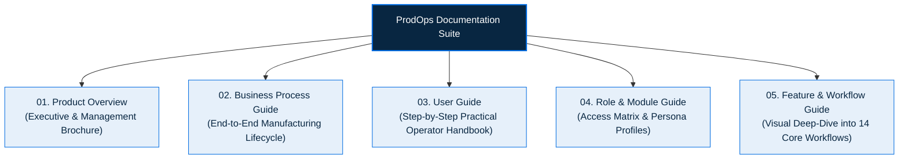

# PRODOPS — PRODUCTION PLANNING, EXECUTION & QUALITY PLATFORM
## Enterprise Client-Facing Documentation Suite

> **Product**: ProdOps  
> **Tagline**: Production Planning, Execution & Quality Platform  
> **Company**: Abhiyanta India Solutions Pvt. Ltd.  
> **Domain**: Production Planning • Production Execution • Quality Control • Operations Management  
> **System Alignment**: Designed for SAP S/4HANA-Oriented Production Processes  
> **Document Release**: Enterprise Edition 2026.1  

---

## Executive Welcome

Welcome to the **ProdOps Enterprise Documentation Suite**. 

ProdOps provides an intuitive, unified operational workspace that connects manufacturing planning, shop-floor execution, quality assurance, and inventory logistics into a single, cohesive business environment. Designed to complement enterprise manufacturing landscapes and aligned with SAP S/4HANA production workflows, ProdOps bridges the gap between high-level enterprise planning and daily shop-floor operational execution.

This documentation suite has been crafted specifically for business stakeholders, executive decision-makers, plant leadership, production supervisors, planners, operators, and quality inspectors. It emphasizes **business processes, operational workflows, and practical user tasks**, deliberately excluding internal software implementation details to deliver immediate clarity and actionable value.

---

## Documentation Suite Overview

The ProdOps documentation suite consists of five specialized guides, each tailored to distinct operational and management needs:

---

## Document Catalog & Reading Guide

| Document | Title | Target Audience | Primary Focus | Recommended For |
|---|---|---|---|---|
| **Doc 01** | [**Product Overview**](./01_PRODOPS_PRODUCT_OVERVIEW.md) | Plant Managers, Operations Directors, C-Level Executives | High-level value proposition, challenges addressed, platform capabilities, business benefits | Product presentations, management evaluations, client demonstrations |
| **Doc 02** | [**Business Process Guide**](./02_PRODOPS_BUSINESS_PROCESS_GUIDE.md) | Production Planners, Business Analysts, Manufacturing Leads | Complete lifecycle of a production order, status transitions (CRTD to CLSD), goods movements, quality gates | Business process alignment, standard operating procedure (SOP) design |
| **Doc 03** | [**User Guide**](./03_PRODOPS_USER_GUIDE.md) | Shop Floor Operators, Planners, Quality Inspectors, Storekeepers | Screen-by-screen practical instructions, visual callouts, step-by-step actions, and expected results | Daily operational training, user onboarding, operational support |
| **Doc 04** | [**Role & Module Guide**](./04_PRODOPS_ROLE_AND_MODULE_GUIDE.md) | Department Heads, System Managers, HR & Training Coordinators | 8 distinct business personas, screen permissions, role-to-module matrix, cross-functional collaboration | User access provisioning, organizational change management |
| **Doc 05** | [**Feature & Workflow Guide**](./05_PRODOPS_FEATURE_AND_WORKFLOW_GUIDE.md) | Operations Specialists, Continuous Improvement Teams, Plant Engineers | Visual walkthrough of 14 core manufacturing workflows with screenshots and operational considerations | Deep functional evaluation, workflow optimization, training masterclasses |

---

## Key Platform Highlights

> [!NOTE]
> **Enterprise Integration Posture**  
> ProdOps is designed to provide a streamlined operational experience around SAP S/4HANA production processes. It keeps production orders, component availability, operation confirmations, goods movements, and quality inspection lots continuously synchronized with the central SAP enterprise system.

1. **Unified Operational Hub**: Consolidates fragmented production activities—order monitoring, component reservations, operation confirmations, goods issues, goods receipts, and quality usage decisions—into a single modern workspace.
2. **Strict Manufacturing Rules**: Enforces discrete and process manufacturing integrity at every step, including chronological status progression (`CRTD` → `REL` → `CNF` → `TECO` → `CLSD`), mandatory component checks, and safety pre-checks before technical completion.
3. **Role-Tailored User Experience**: Each user sees only what their operational job demands. An operator focuses on operation yield confirmations; a quality inspector focuses on result recording; a planner oversees order scheduling and material reservations.
4. **Independent 3-Dimension Status Architecture**: Preserves total data integrity by tracking system operational status, goods issue fulfillment status, and goods receipt status independently, preventing shop-floor postings from corrupting header milestone progress.
5. **Real-Time Operational Awareness**: Operators, supervisors, and planners share instant visibility of line activities without requiring manual phone calls, paper slips, or repeated manual report generation.

---

## Contact & Governance

**Abhiyanta India Solutions Pvt. Ltd.**  
Enterprise Manufacturing Solutions Division  
*Email*: info@abhiyantaindia.com | *Web*: [www.abhiyantaindia.com](https://www.abhiyantaindia.com)  
*Product Version*: ProdOps 2026.1 Enterprise Edition  
*Document Suite Revision*: 1.0 (Audit-Verified & Certified)  
