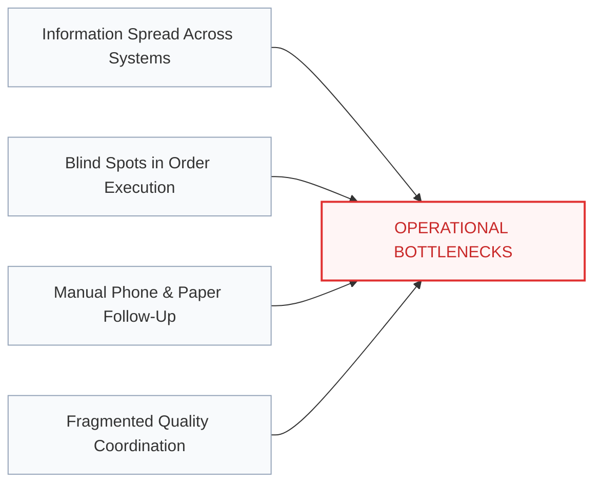
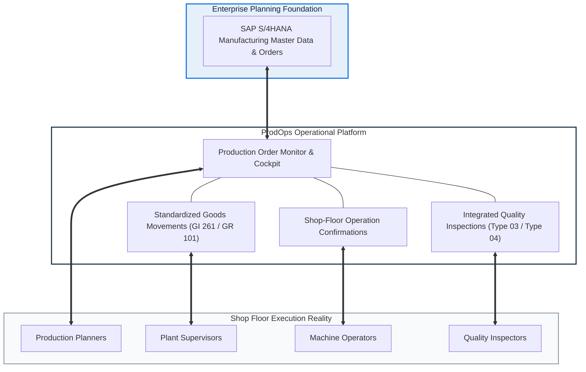
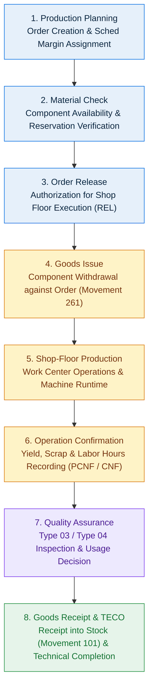

# PRODOPS — PRODUCT OVERVIEW
## Production Planning, Execution & Quality Platform

> **Document Type**: Client-Facing Executive Product Overview  
> **Product Name**: ProdOps  
> **Tagline**: Production Planning, Execution & Quality Platform  
> **Company**: Abhiyanta India Solutions Pvt. Ltd.  
> **Target Audience**: Plant Leadership, Operations Directors, Business Heads, SAP Stakeholders  
> **Document Code**: DOC-PROD-01-2026  

---

## 1. Executive Summary

In contemporary discrete and process manufacturing environments, maintaining seamless synchronization between strategic enterprise planning and shop-floor manufacturing execution is critical to operational success.

**ProdOps** is an enterprise-grade **Production Planning, Execution & Quality Platform** developed by **Abhiyanta India Solutions Pvt. Ltd.** Designed to work in concert with SAP S/4HANA production environments, ProdOps provides a unified, intuitive workspace that streamlines the entire production order lifecycle. By integrating order scheduling, material availability checks, operation confirmations, goods movements, and quality inspections into an accessible operational cockpit, ProdOps empowers cross-functional teams to eliminate operational latency, reduce paperwork, and achieve complete shop-floor transparency.

*Figure 1.1: The ProdOps Executive Operational Dashboard, providing real-time visibility into active production orders, confirmation rates, and quality lot statuses.*

---

## 2. Common Manufacturing Challenges

Modern plant managers, production planners, and shop-floor personnel encounter substantial day-to-day friction when managing production lifecycles across disconnected tools and legacy interfaces:

* **Disparate Operational Information**: Critical production information—such as component stock reservations, machine runtimes, and yield figures—is frequently siloed, forcing teams to consult multiple disconnected screens.
* **Limited Shop-Floor Visibility**: Supervisors and plant managers often cannot immediately verify whether an order is actively running on a work center, paused due to material shortages, or awaiting quality clearance.
* **Intensive Manual Follow-Up**: Production controllers and expediters spend considerable hours chasing verbal updates, walking the shop floor, or emailing department leads to determine actual order progress.
* **Material Movement Blind Spots**: Component issues (Movement 261) and finished goods receipts (Movement 101) are often delayed or recorded hours after the physical movements occur, resulting in discrepancies between physical floor stock and recorded balances.
* **Fragmented Quality Handshakes**: Quality inspections frequently operate in an isolated channel, creating delays in approving produced batches for commercial dispatch or subsequent assembly stages.

---

## 3. The ProdOps Solution

ProdOps resolves these bottlenecks by delivering an intuitive, unified operational layer that centralizes plant execution while upholding enterprise data consistency.

ProdOps translates enterprise production schedules into clear, role-specific action lists. Machine operators execute their assigned operations without exposure to unnecessary planning parameters; storekeepers handle component staging and goods issues with clear material references; and quality personnel record sample findings directly against the production lot. Every action is coordinated through a shared operational thread.

---

## 4. Key Platform Capabilities

ProdOps delivers comprehensive functional coverage tailored to the core stages of discrete and process manufacturing:

*Figure 1.2: Centralized Production Order Monitor with multi-criteria filtering, status pills, and SAP alignment badges.*

### 4.1 Production Order Monitoring & Search
* **Central Order Cockpit**: View, search, and filter production orders across multiple manufacturing plants, storage locations, and execution statuses (`CRTD`, `REL`, `PCNF`, `CNF`, `TECO`, `CLSD`).
* **Real-Time Status Badges**: High-contrast visual indicators immediately convey whether an order is created, released to the shop floor, partially confirmed, fully completed, or technically closed.

### 4.2 Order Detail & Scheduling Management
* **Structured Order Views**: Access comprehensive order headers organized into dedicated business sections: General Information, Plant Assignments, Goods Receipt Rules, Control Data, and Master Data references.
* **Component Overview & Availability**: Inspect required Bill of Materials (BOM) components, verified stock availability, and missing parts before releasing orders to work centers.

### 4.3 Shop-Floor Operation Execution & Confirmations
* **Work Center Operation Sequences**: Review detailed routing steps, sequence numbers, work center codes, and planned setup and machine durations.
* **Yield & Scrap Recording**: Report produced quantities, scrap counts, and actual operational runtimes with clear distinction between partial and final confirmations.

### 4.4 Standardized Goods Movements
* **Component Issue (Movement 261)**: Issue raw materials and sub-assemblies against specific production orders and reservations, automatically updating consumption records.
* **Finished Goods Receipt (Movement 101)**: Receive completed assemblies into finished-goods storage locations upon operational completion.
* **Movement Reversals (Movements 102 & 262)**: Perform authorized reversals and cancellations with full preservation of audit records and document linkages.

### 4.5 Built-In Quality Control Gates
* **In-Process Inspection (Type 03)**: Record inspection samples during active production operations to identify defects before mass processing.
* **Final Goods Inspection (Type 04)**: Perform comprehensive quality evaluations on finished batches before releasing stock to unrestricted inventory.
* **Usage Decisions (UD)**: Grant formal Usage Decisions (Accepted `UDAC` or Rejected `UDRJ`) to control downstream material flow.

---

## 5. End-to-End Operational Flow

ProdOps standardizes manufacturing operations across an established eight-stage progression:

1. **Production Planning**: Planners establish production requirements, select finished materials, assign target quantities, and establish forward or backward scheduling.
2. **Material Check**: The platform verifies component availability against current stock to ensure jobs are not dispatched without necessary parts.
3. **Order Release**: Once validated, the order is released (`REL`), enabling the generation of shop-floor work orders.
4. **Goods Issue**: Storekeepers issue reserved components to the order using standardized Movement Type 261.
5. **Shop-Floor Production**: Machine operators execute assigned work sequences across designated work centers.
6. **Operation Confirmation**: Operators record confirmed yield, scrap quantities, and elapsed machine and labor hours.
7. **Quality Assurance**: In-process or post-production inspection lots are evaluated, with usage decisions determining final acceptance.
8. **Goods Receipt & TECO**: Finished goods are posted into warehouse inventory via Movement Type 101, and the order is brought to Technical Completion (`TECO`).

---

## 6. Measurable Business Benefits

Implementing ProdOps provides clear operational advantages across the manufacturing enterprise:

| Business Dimension | Traditional Manual Operations | With ProdOps Platform |
|---|---|---|
| **Operational Visibility** | Information scattered across paper travelers and siloed screens | Single, unified cockpit with live order, operation, and inventory status |
| **Material Traceability** | Delayed component consumption postings leading to floor stock variances | Prompt goods issue (261) and receipt (101) directly linked to orders |
| **Decision Velocity** | Planners rely on end-of-shift reports to detect production delays | Immediate visibility of bottlenecks, scrap occurrences, and stalled jobs |
| **Quality Compliance** | Disconnected quality spreadsheets and paper sign-offs | Integrated inspection lots (Type 03/04) with auditable usage decisions |
| **User Productivity** | Operators navigate complex, multi-layered enterprise transaction codes | Streamlined, role-tailored screens focused entirely on the user's specific tasks |
| **Data Integrity** | High potential for conflicting status overrides | 3-dimension status architecture ensuring milestone progress remains intact |

---

## 7. Enterprise SAP Alignment

> [!NOTE]
> **Enterprise Design Posture**  
> ProdOps is designed for SAP S/4HANA-oriented production processes and built to deliver a simplified, human-centered operational experience. ProdOps keeps production orders, component requirements, and inventory postings synchronized with SAP S/4HANA where configured and supported.

ProdOps adopts standard SAP manufacturing terminology, data conventions, and status flows:

* **Standard Status Progression**: Employs industry-standard statuses (`CRTD`, `REL`, `PCNF`, `CNF`, `TECO`, `CLSD`).
* **Standard Movement Types**: Utilizes established inventory movement conventions (`261` for component issue, `101` for finished goods receipt, `102`/`262` for reversals).
* **Two-Way Synchronization**: Synchronizes order changes, status updates, confirmations, and material documents with the enterprise core, ensuring financial and inventory books remain perfectly balanced.

---

## 8. Closing & Contact Information

ProdOps bridges the gap between enterprise manufacturing strategy and shop-floor reality, giving plant personnel the tools they need to execute with precision, confidence, and speed.

**ProdOps — Production Planning, Execution & Quality Platform**  
*A Product of Abhiyanta India Solutions Pvt. Ltd.*  
*Address*: Pune • Bengaluru • Hyderabad, India  
*Website*: [www.abhiyantaindia.com](https://www.abhiyantaindia.com)  
*General Inquiries*: contact@abhiyantaindia.com  
*Enterprise Solutions Group*: prodops-solutions@abhiyantaindia.com  
