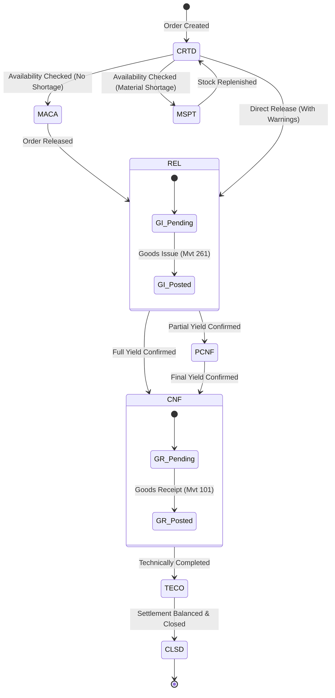
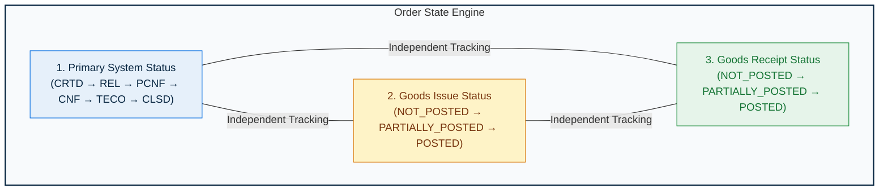
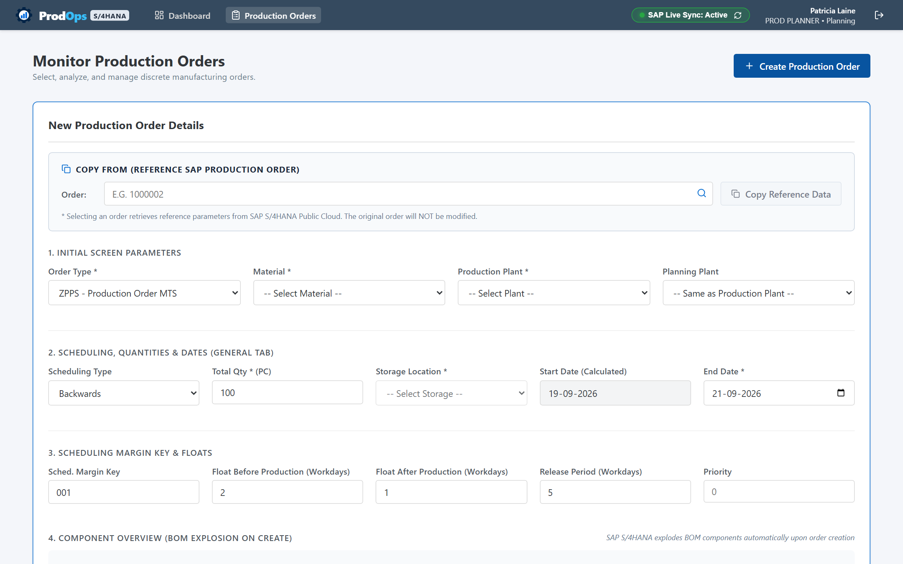
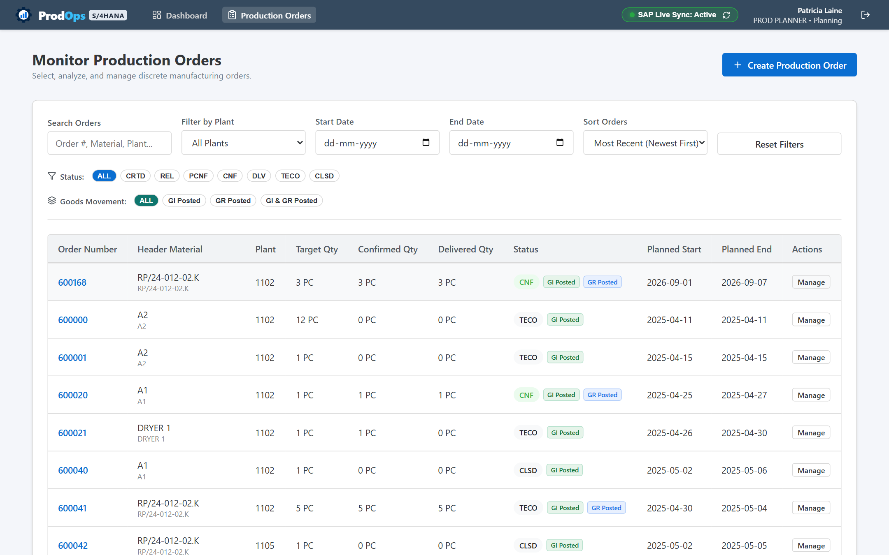
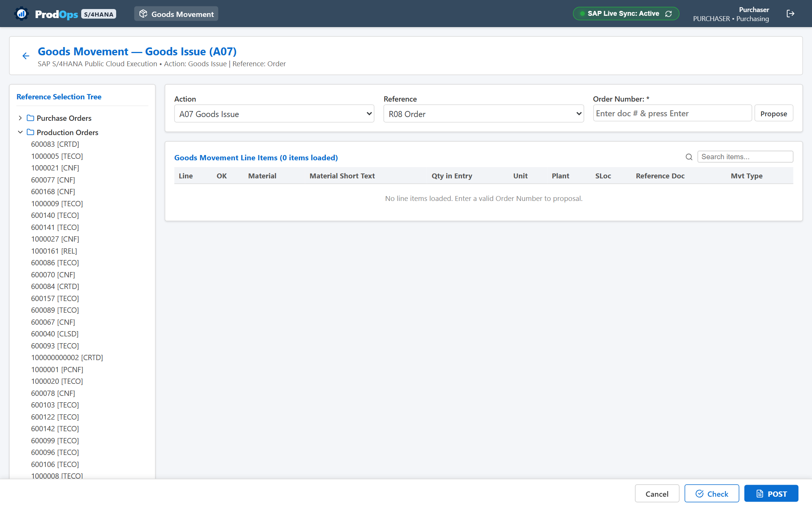
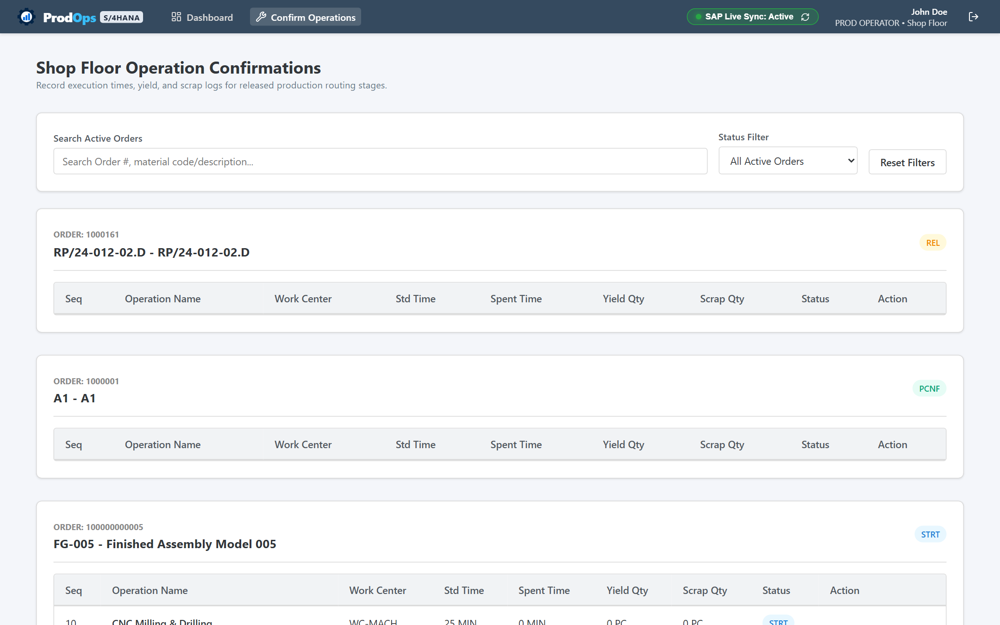
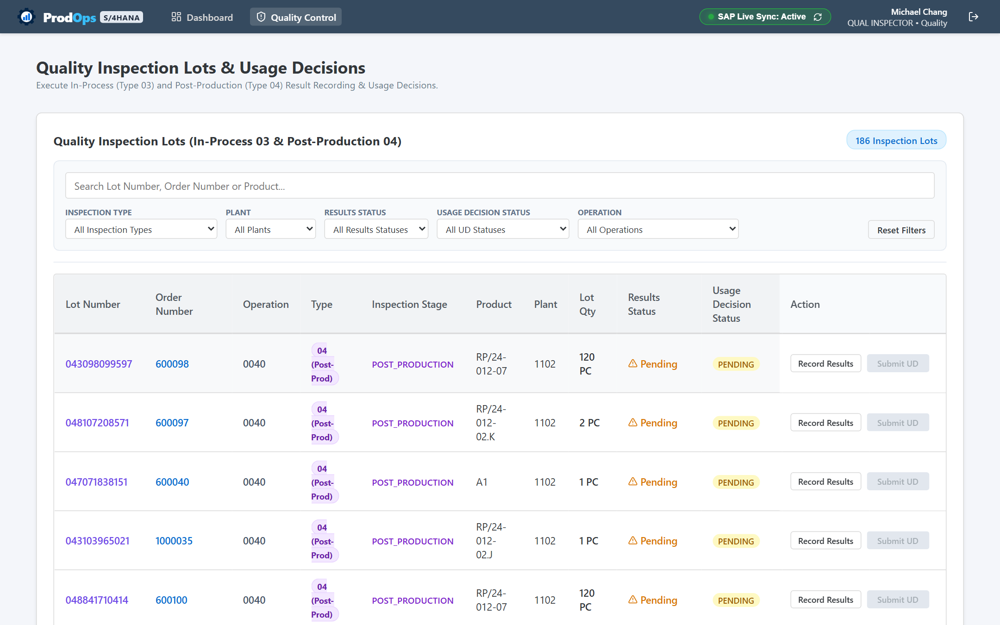

# PRODOPS — BUSINESS PROCESS GUIDE
## End-to-End Manufacturing Lifecycle & Business Rules

> **Document Type**: Client-Facing Business Process Guide  
> **Product Name**: ProdOps  
> **Tagline**: Production Planning, Execution & Quality Platform  
> **Company**: Abhiyanta India Solutions Pvt. Ltd.  
> **Target Audience**: Production Planners, Manufacturing Engineers, Business Analysts, Plant Supervisors  
> **Document Code**: DOC-PROD-02-2026  

---

## 1. Production Order Overview

In discrete and process manufacturing, a **Production Order** is the foundational business document that authorizes the transformation of raw materials and sub-assemblies into finished marketable goods.

A Production Order defines:
* **What** material is to be manufactured (Finished Assembly or Sub-assembly).
* **Where** the production takes place (Plant, Work Centers, and Storage Locations).
* **When** manufacturing operations occur (Planned Start Date, Planned Finish Date).
* **How Much** is to be produced (Target Quantity and Unit of Measure).
* **Which Components** are consumed (Bill of Materials reservations).
* **Which Operation Steps** are executed (Routing sequences, setup time, and machine runtime).
* **Cost Accounting Object**: An internal order against which actual material consumption costs and operational machine/labor hours are debited.

ProdOps models this entire operational workflow to maintain strict manufacturing discipline, protect product quality, and ensure seamless synchronization with SAP S/4HANA production processes.

---

## 2. Production Order Lifecycle & System Statuses

ProdOps guides every manufacturing order through a disciplined chronological lifecycle. Each state transition reflects an authentic physical event on the plant floor.

### 2.1 Standard Status Terminology

| Status Code | Status Name | Operational Definition & Business Rules |
|---|---|---|
| **CRTD** | Created | The order is generated with basic dates and target quantity. Material reservations and operation steps are planned, but work center execution is not yet authorized. |
| **MACA** | Material Availability Checked | A formal availability check has evaluated all required components against available inventory with no shortages detected. |
| **MSPT** | Material Shortage | An availability check revealed that one or more critical components lack sufficient unreserved stock. Planners must address shortages before dispatch. |
| **REL** | Released | The order is officially released to the shop floor. Material reservations become active for withdrawal, and operators can begin machine setup and execution. |
| **PCNF** | Partially Confirmed | Shop floor personnel have reported partial progress or yield against one or more operation steps. Production is actively underway. |
| **CNF** | Confirmed | All planned operation routing steps have received final confirmations. Total yield has been fully reported. |
| **TECO** | Technically Completed | Physical manufacturing is finished. No further goods issues or confirmations are anticipated. Order enters financial variance calculation. |
| **CLSD** | Closed | The order is financially settled ($\text{Actual Costs} - \text{Credits} = 0$), and all balance items are cleared. The order is locked against any further transactions. |

---

## 3. The 3-Dimension Independent Status Architecture

To avoid operational confusion and prevent accidental state corruption, ProdOps organizes order tracking across **three independent dimensions**:

1. **System Operational Status**: Tracks where the order stands in its overall execution hierarchy (`CRTD`, `REL`, `PCNF`, `CNF`, `TECO`, `CLSD`).
2. **Goods Issue Fulfillment Status**: Tracks component withdrawal independent of operation confirmations. Posting raw material withdrawals via Movement 261 updates this dimension without prematurely altering the order's primary status.
3. **Goods Receipt Delivery Status**: Tracks finished goods receipts into stock via Movement 101. An order can be confirmed (`CNF`) on the floor before warehouse intake is finalized, ensuring both logistics and production retain accurate independent records.

---

## 4. Phase-by-Phase Business Process

### 4.1 Step 1: Order Creation & Planning
* **Objective**: Define what to produce, in what quantity, and by when.
* **Planner Action**:
  1. Select the finished material code and receiving plant.
  2. Enter the target quantity and receiving storage location.
  3. Set planned start and finish dates using forward or backward scheduling.
  4. Specify scheduling margin keys (float before production, float after production, and release period).
* **Business Outcome**: System generates an order header with initial status `CRTD`, automatically exploding the active Bill of Materials (BOM) to create material reservations and generating routing operation steps.

*Figure 2.1: ProdOps Order Creation interface showing material selection, target quantity, and scheduling parameters.*

### 4.2 Step 2: Material Availability Verification
* **Objective**: Ensure that physical raw materials and components are available in inventory before dispatching jobs to machine operators.
* **Planner Action**: Click **Check Material Availability** on the order action bar.
* **Business Outcome**:
  * If all components have sufficient stock: Status advances to `MACA` (Material Availability Checked).
  * If shortages exist: Status transitions to `MSPT` (Material Shortage). The system generates a Missing Parts Overview highlighting the deficit quantity for each affected component.

### 4.3 Step 3: Production Order Release
* **Objective**: Authorize the plant floor to commence setup, material staging, and physical processing.
* **Supervisor/Planner Action**: Select **Release Order** on the action toolbar.
* **Business Outcome**:
  * Status flips from `CRTD` / `MACA` to `REL` (Released).
  * Material reservations become open for warehouse withdrawal.
  * Operation routing lines become active in operator work queues.

*Figure 2.2: Production Order Detail view in released state (`REL`), displaying general data, scheduling dates, and live status badges.*

### 4.4 Step 4: Goods Issue (Component Withdrawal — Movement Type 261)
* **Objective**: Issue raw materials, purchased components, and sub-assemblies from warehouse stock to the production order.
* **Storekeeper/Purchaser Action**:
  1. Open the Goods Movement workspace (`/goods-issue`).
  2. Select transaction **Goods Issue (`A07`)** with reference to **Order (`R08`)**.
  3. Enter the Order Number. The system retrieves reserved components automatically.
  4. Enter the actual issued quantities and source storage location.
  5. Post the movement.
* **Business Rules & Movement Impact**:
  * **Movement 261**: Posts inventory withdrawal for an order.
  * Decreases warehouse inventory balance.
  * Debits the production order cost collector with actual material costs.
  * Updates the component's withdrawn quantity and advances the order's `goodsIssueStatus`.

*Figure 2.3: Goods Movement screen configured for Movement 261 component withdrawals.*

### 4.5 Step 5: Shop-Floor Production & Operation Confirmations
* **Objective**: Execute physical machining, assembly, and testing operations, recording yield and labor/machine time.
* **Operator Action**:
  1. Navigate to the **Confirm Operations** workspace (`/operations`).
  2. Select the active order and operation step (e.g., `0010 - Rough Turning`).
  3. Enter confirmed **Yield Quantity**, **Scrap Quantity**, and actual **Time Spent**.
  4. Specify whether this is a **Partial Confirmation** (work continues) or **Final Confirmation** (operation completed).
* **Business Rules & Confirmation Impact**:
  * Partial confirmation shifts the order status to `PCNF`.
  * When the final operation receives final confirmation, the order automatically transitions to `CNF` (Confirmed).
  * Operational labor and machine costs are posted against the production order.

*Figure 2.4: Operator confirmation dialog capturing yield, scrap, and machine time.*

### 4.6 Step 6: Integrated Quality Assurance (Inspection Types 03 & 04)
* **Objective**: Verify that intermediate operations and finished products comply with engineering specifications.
* **Quality Inspector Action**:
  1. Open the **Quality Control** workspace (`/quality`).
  2. Select the assigned inspection lot:
     * **Type 03 (In-Process)**: Evaluated during active machining or assembly.
     * **Type 04 (Post-Production / Goods Receipt)**: Evaluated upon completion of manufacturing.
  3. Perform **Result Recording**: Enter inspected sample quantity and defect observations.
  4. Make formal **Usage Decision**: Select **Accepted (`UDAC`)** or **Rejected (`UDRJ`)**.
* **Business Outcome**:
  * Accepted goods are approved for warehouse intake or downstream processing.
  * Rejected goods trigger containment protocols and scrap logging.

*Figure 2.5: Quality Inspection Lot management with Result Recording and Usage Decisions.*

### 4.7 Step 7: Goods Receipt for Finished Production (Movement Type 101)
* **Objective**: Receive manufactured finished goods into unrestricted warehouse inventory.
* **Warehouse / Storekeeper Action**:
  1. Open the Goods Movement workspace or trigger Goods Receipt from the Order Detail screen.
  2. Confirm produced quantity, receiving plant, and target storage location.
  3. Post Goods Receipt via **Movement Type 101**.
* **Business Rules & Receipt Impact**:
  * Increases finished goods warehouse inventory.
  * Credits the production order for the value of the delivered goods.
  * Updates the order's `deliveredQty` and marks `goodsReceiptStatus` as `POSTED`.

### 4.8 Step 8: Goods Movement Reversals & Cancellations (Movements 102 & 262)
* **Objective**: Correct erroneous postings or handle line rejections requiring material returns.
* **Supported Reversals**:
  * **Goods Receipt Reversal (`101 → 102`)**: Used when delivered finished goods are discovered to be damaged or miscounted during warehouse intake. Reverses the inventory credit and reopens the delivered balance.
  * **Goods Issue Reversal (`261 → 262`)**: Used when surplus raw materials are returned from the shop floor back to warehouse inventory. Re-credits the warehouse stock and removes the cost debit from the order.
* **Governance**: Reversals require reference to the original material document number and retain a complete audit record.

### 4.9 Step 9: Technical Completion (TECO) & Order Closure (CLSD)
* **Objective**: Formally close the production order from operational and financial standpoints.
* **Process Rules**:
  1. **Technical Completion (`TECO`)**:
     * Performed when physical production is done, even if target yield was slightly under or over delivered.
     * Open component reservations are automatically cancelled.
     * The order status advances to `TECO`.
     * If needed, authorized plant supervisors can execute **Revoke TECO** to reopen the order for corrective bookings.
  2. **Order Closure (`CLSD`)**:
     * Performed after all financial period-end variance calculations and settlements are finished.
     * Prerequisite rule: The order financial balance must equal zero ($\text{Actual Costs} - \text{Credits} = 0$).
     * Once set to `CLSD`, no further bookings, time postings, or inventory movements can occur.

---

## 5. End-to-End Business Process Matrix

| Stage | Responsible Role | Key Inputs | Primary System Action | Output Status / Document |
|---|---|---|---|---|
| **1. Create** | Production Planner | Material Code, Plant, Target Qty, Dates | Create Order | Order # generated, Status: `CRTD` |
| **2. Material Check** | Production Planner | Component Reservations, Stock Levels | Check Availability | Status: `MACA` or `MSPT` |
| **3. Release** | Planner / Supervisor | Order #, Material Availability | Release Order | Status: `REL`, Reservations Open |
| **4. Goods Issue** | Storekeeper / Purchaser | Order #, Storage Location, Qty | Post Movement `261` | Material Document, `GI: POSTED` |
| **5. Confirmation** | Machine Operator | Operation #, Yield Qty, Scrap, Hours | Confirm Operation | Operation `CNF`, Status: `PCNF`/`CNF` |
| **6. Quality Gate** | Quality Inspector | Inspection Lot #, Sample Size | Result Recording & UD | Usage Decision: `UDAC` or `UDRJ` |
| **7. Goods Receipt** | Warehouse Staff | Order #, Yield Qty, Storage Location | Post Movement `101` | Material Document, `GR: POSTED` |
| **8. Completion** | Plant Supervisor | Final Yield Verified, Open Balances | Technical Complete | Status: `TECO` |
| **9. Closure** | Plant / Finance Manager | Cost Settlement Balance = 0 | Close Order | Status: `CLSD` |

---

## 6. Business Process Summary

The ProdOps business process enforces end-to-end discipline from initial scheduling through final financial closure. By separating milestone status from inventory postings and integrating quality gates directly into shop-floor execution, ProdOps ensures manufacturing organizations achieve high throughput without sacrificing regulatory compliance, inventory accuracy, or cost control.
