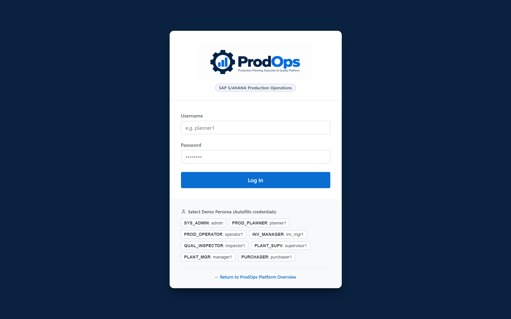

# PRODOPS — USER GUIDE
## Practical Operational Handbook & Screen-by-Screen Reference

> **Document Type**: Client-Facing Practical User Manual  
> **Product Name**: ProdOps  
> **Tagline**: Production Planning, Execution & Quality Platform  
> **Company**: Abhiyanta India Solutions Pvt. Ltd.  
> **Target Audience**: Production Planners, Machine Operators, Quality Inspectors, Plant Supervisors, Storekeepers  
> **Document Code**: DOC-PROD-03-2026  

---

## 1. Introduction & Getting Started

The **ProdOps User Guide** is a hands-on instructional manual designed to help manufacturing personnel execute daily operational tasks efficiently and accurately. 

Every section in this guide follows a standardized instructional structure:
* **Screenshot**: An authentic view of the application interface with numbered callouts.
* **What This Screen Does**: A clear operational explanation of the screen's purpose.
* **When to Use It**: The specific business situation requiring this screen.
* **Step-by-Step Process**: Sequential instructions detailing what to click, select, and enter.
* **Expected Result**: The concrete operational outcome upon completion.

---

## 2. Accessing the Platform & User Login

*Figure 3.1: ProdOps Sign-In Screen with credential fields and quick-select role personas.*

### Callout Breakdown
* **① ProdOps Platform Identity**: Displays the application branding and S/4HANA-aligned operational environment.
* **② Username Field**: Enter your assigned enterprise user ID.
* **③ Password Field**: Enter your secure password.
* **④ Sign In Button**: Authenticates credentials and opens your role-assigned workspace.
* **⑤ Persona Quick-Select Panel**: In evaluation environments, allows rapid switching between business personas (Planner, Operator, Inspector, Supervisor, Manager, Purchaser).

### What This Screen Does
Authenticates users and loads their personalized workspace based on their specific operational role.

### When to Use It
At the beginning of each work shift or whenever switching between distinct user profiles.

### Step-by-Step Process
1. Open your web browser and navigate to the ProdOps URL (`http://<host>:5173/login`).
2. Enter your **Username** in field ②.
3. Enter your **Password** in field ③.
4. Click **Sign In** ④.
   * *Tip for Training / Demos*: Click any pre-configured role in panel ⑤ (e.g., `Patricia Laine (Planner)` or `John Doe (Operator)`) to populate credentials instantly.

### Expected Result
The system verifies your credentials and directs you to the main dashboard or your role's primary operational workspace.

---

## 3. Executive Dashboard

*Figure 3.2: ProdOps Executive Dashboard featuring live operational KPI tiles and order distribution analytics.*

### Callout Breakdown
* **① Global Shell Navigation Bar**: Quick navigation across Dashboard, Production Orders, Operations, Quality, Goods Movements, and Inventory.
* **② Operational KPI Tiles**: High-level counters tracking Total Orders, Active Execution, Pending Confirmations, Quality Lots, and Completed Orders.
* **③ Quick-Action Launchers**: Single-click access to frequently executed daily workflows.
* **④ Order Status Distribution Chart**: Visual summary of orders across `CRTD`, `REL`, `PCNF`, `CNF`, `TECO`, and `CLSD`.
* **⑤ Recent Operational Activity**: Live chronological feed of recent production events, status changes, and confirmations.

### What This Screen Does
Provides a consolidated, real-time snapshot of overall plant operations, throughput bottlenecks, and pending quality gates.

### When to Use It
* At the beginning of each shift to evaluate workload.
* During operational stand-ups and daily management meetings.

### Step-by-Step Process
1. Review the summary metrics across KPI tiles ② to identify pending backlogs.
2. Examine the Status Distribution chart ④ to see order distribution across execution phases.
3. Click any KPI card or quick-action button ③ to drill directly into filtered lists.

### Expected Result
Immediate awareness of plant operational status without manually compiling shift reports.

---

## 4. Production Order Monitor

*Figure 3.3: Production Order Monitor featuring search filters, status pills, and SAP alignment badges.*

### Callout Breakdown
* **① Search Bar**: Real-time search by Order Number, Finished Material Code, or Material Description.
* **② Primary Status Filter**: Filter orders by milestone (`ALL`, `CRTD`, `REL`, `PCNF`, `CNF`, `TECO`, `CLSD`).
* **③ Goods Movement Filter**: Filter orders by inventory fulfillment (`ALL`, `GI Pending`, `GI Posted`, `GR Pending`, `GR Posted`).
* **④ Plant Selector**: Restrict list to specific manufacturing facilities (e.g., `PL01 - Dallas Assembly Plant`).
* **⑤ Create Production Order Button**: Opens the modal dialog to create a new manufacturing order.
* **⑥ Order Data Grid**: Interactive table displaying order numbers, finished goods, target quantities, confirmed yield, delivered amounts, dates, and live status pills.
* **⑦ SAP Synchronization Indicator**: Confirms live data alignment with the central enterprise system (`✓ SAP`).

### What This Screen Does
Serves as the primary operational cockpit for monitoring, searching, and managing all production orders across the enterprise.

### When to Use It
To locate specific production orders, evaluate floor progress, verify inventory postings, or initiate order creation.

### Step-by-Step Process
1. Enter an order number or material name in the **Search Bar** ①.
2. Select desired criteria from the **Status Filter** ②, **Movement Filter** ③, or **Plant Selector** ④.
3. Click on any **Order Number** link in column ⑥ to open the full order details.

### Expected Result
The data table filters instantly to display matching orders with current yield and status metrics.

---

## 5. Creating a Production Order

*Figure 3.4: Order Creation dialog with master data selectors and scheduling margins.*

### Callout Breakdown
* **① Material Selector**: Dropdown to select the finished assembly or sub-assembly.
* **② Production Plant**: Manufacturing facility where the order will be produced.
* **③ Storage Location**: Target warehouse location for completed goods intake.
* **④ Target Quantity & Unit**: Total planned production quantity.
* **⑤ Scheduling Dates**: Planned Start Date and Planned Finish Date.
* **⑥ Scheduling Margins**: Configuration for float before production, float after production, and release period.
* **⑦ Initial Status Selection**: Toggle between immediate `CRTD` status or draft saving.
* **⑧ Create Order Action**: Validates input and generates the order.

### What This Screen Does
Allows authorized production planners to generate new manufacturing orders, exploding the Bill of Materials and scheduling operation sequences.

### When to Use It
When demand requirements (sales orders, planned orders, or safety stock thresholds) call for a new manufacturing batch.

### Step-by-Step Process
1. Click **Create Production Order** ⑤ on the Order Monitor toolbar.
2. In the modal dialog, select the **Material** ①.
3. Choose the **Production Plant** ② and **Storage Location** ③.
4. Enter the **Target Quantity** ④ (e.g., `100 EA`).
5. Specify the **Planned Start Date** and **Planned Finish Date** ⑤.
6. Verify scheduling margin parameters ⑥.
7. Click **Create Order** ⑧.

### Expected Result
A new 10-digit production order number (e.g., `1000000011` or `600100`) is generated in status `CRTD` with active component reservations and operation steps.

---

## 6. Production Order Detail & Header Management

*Figure 3.5: Production Order Detail view showing header tabs, operational metrics, and the SAP Action Toolbar.*

### Callout Breakdown
* **① Back Navigation**: Returns immediately to the Production Order Monitor.
* **② Order Header Summary**: Displays Order Number, Material Code, Material Description, Target Quantity, and Plant.
* **③ Real-Time Status Pills**: Visual indicators for primary system status, goods issue fulfillment, and goods receipt delivery.
* **④ SAP Action Toolbar**: Core operational actions:
  * `↻ Refresh from SAP`: Pulls current enterprise state on demand.
  * `✓ Release Order`: Authorizes shop-floor execution.
  * `🔍 Check Availability`: Evaluates component inventory.
  * `📅 Schedule Order`: Calculates operational start/finish timings.
  * `⚙ Technical Complete (TECO)`: Marks physical production finished.
* **⑤ Section Tabs**: Switch between General Info, Plant Assignments, Goods Receipt Rules, Control Parameters, and Master Data references.

### What This Screen Does
Provides full 360-degree management of an individual production order, supporting both display (CO03) and authorized change (CO02) workflows.

### When to Use It
Whenever managing, reviewing, releasing, or updating an existing production order.

### Step-by-Step Process
1. Open the desired order from the Order Monitor.
2. Click through the section tabs ⑤ to inspect scheduling parameters, assigned supervisors, and costing controls.
3. To trigger an operational action, click the corresponding button on the **SAP Action Toolbar** ④.

### Expected Result
The order view reflects the latest status and scheduling updates with complete audit logging.

---

## 7. Routing & Sequence Operations

*Figure 3.6: Operation routing grid detailing work centers, planned times, and confirmed yield.*

### Callout Breakdown
* **① Sequence Number**: The chronological step identifier (e.g., `0010`, `0020`, `0030`, `0040`).
* **② Operation Description**: Specific manufacturing task (e.g., *Rough Turning, Precision Milling, Assembly, Testing*).
* **③ Work Center**: Machine group or workstation code (e.g., `WC-LATHE-01`, `WC-MILL-02`).
* **④ Planned Execution Hours**: Scheduled setup time and machine processing duration.
* **⑤ Confirmed Yield**: Actual quantity successfully completed at this operation.
* **⑥ Operation Status Pill**: Individual step status (`REL`, `PCNF`, `CNF`).

### What This Screen Does
Displays the step-by-step routing sequence required to manufacture the finished product, including work center assignments and progress.

### When to Use It
To verify which operations are finished, currently active, or pending on the shop floor.

### Step-by-Step Process
1. Scroll down to the **Routing & Sequence Operations** card on the Order Detail page.
2. Review sequence progress column by column.
3. Note any operation bottlenecks where confirmed yield is lagging behind planned targets.

### Expected Result
Clear visibility into where an order physically resides on the plant floor.

---

## 8. Bill of Materials & Component Reservations

*Figure 3.7: Component reservation table comparing required quantities against withdrawn inventory.*

### Callout Breakdown
* **① Item Number**: BOM position identifier (e.g., `0010`, `0020`).
* **② Component Material Code & Name**: Description of the raw material, part, or sub-assembly.
* **③ Required Quantity**: Total amount needed to fulfill the order's target batch.
* **④ Withdrawn Quantity**: Amount physically issued from the warehouse to the shop floor.
* **⑤ Storage Location**: Designated warehouse bin or staging area for component withdrawal.
* **⑥ Material Status Pill**: Indicates whether the component is fully issued, partially issued, or pending withdrawal.

### What This Screen Does
Tracks all materials reserved for the production order, comparing planned demand against actual warehouse issues.

### When to Use It
* Before releasing an order, to ensure parts are staged.
* During production, to verify whether materials have been withdrawn.

### Step-by-Step Process
1. Scroll to the **Bill of Materials (Component Overview)** card on the Order Detail page.
2. Compare **Required Quantity** ③ against **Withdrawn Quantity** ④.
3. If withdrawn quantity is zero for released orders, notify the warehouse storekeeper to execute Goods Issue (Movement 261).

### Expected Result
Complete assurance that components are accurately tracked and accounted for.

---

## 9. Shop-Floor Operation Confirmations

*Figure 3.8: Operation Confirmation dialog capturing yield, scrap, and machine runtimes.*

### Callout Breakdown
* **① Active Orders Worklist**: List of released orders eligible for shop-floor confirmation.
* **② Operation Selector**: Choose which routing step is being reported.
* **③ Confirmed Yield Field**: Enter acceptable pieces produced.
* **④ Scrap Quantity Field**: Enter defective pieces rejected during the run.
* **⑤ Actual Time Spent**: Enter machine or labor minutes consumed.
* **⑥ Final Confirmation Checkbox**: Tick if this operation step is completely finished.
* **⑦ Posting Date**: Accounting date for labor/machine cost debit.
* **⑧ Confirm Operation Button**: Submits the confirmation.

### What This Screen Does
Records actual shop-floor production progress, updating order yield, logging scrap, and debiting operational runtimes.

### When to Use It
At the completion of an operation run, at shift change, or after completing a discrete production lot.

### Step-by-Step Process
1. Navigate to **Confirm Operations** (`/operations`) in the top navigation bar.
2. Select the order and click **Confirm** on the target operation step ②.
3. In the modal dialog, enter the **Yield Quantity** ③.
4. If parts were scrapped, enter the **Scrap Quantity** ④.
5. Enter **Time Spent** in minutes ⑤.
6. Check **Final Confirmation** ⑥ if no further work will occur on this step.
7. Click **Confirm Operation** ⑧.

### Expected Result
* Operation status updates to `CNF` (or `PCNF` if unticked).
* Order yield updates across all system screens.
* Order primary status advances to `PCNF` or `CNF`.

---

## 10. Standardized Goods Movements (MIGO Style)

*Figure 3.9: Standardized Goods Movement workspace supporting Goods Issue (261), Goods Receipt (101), and Cancellations (A03).*

### Callout Breakdown
* **① Transaction Type Selector**: Choose between `Goods Issue (A07)`, `Goods Receipt (A01)`, `Cancellation (A03)`, or `Display (A04)`.
* **② Reference Type Selector**: Reference an `Order (R08)`, `Purchase Order (R01)`, or `Material Document (R02)`.
* **③ Document Number Input**: Enter the target Production Order or Material Document number.
* **④ Item Detail Tabs**: Inspect detailed item data across *Material*, *Quantity*, *Where (Plant/Storage Location)*, and *Account Assignment*.
* **⑤ Item Overview Grid**: Multi-line item list with material codes, descriptions, and quantities.
* **⑥ Check Action**: Validates entries against stock availability and order status before posting.
* **⑦ Post Action**: Finalizes the movement and generates a formal Material Document.

### What This Screen Does
Provides a centralized, standardized interface for issuing raw materials, receiving finished products, and executing movement reversals.

### When to Use It
* To withdraw reserved components to an order (Goods Issue 261).
* To post finished assemblies into warehouse inventory (Goods Receipt 101).
* To cancel or reverse an erroneous movement (Cancellations 102/262).

### Step-by-Step Process for Goods Issue (Movement 261)
1. Navigate to **Goods Movement** (`/goods-issue`).
2. Set **Transaction Type** ① to `Goods Issue` and **Reference** ② to `Order`.
3. Enter the **Order Number** in field ③ and press Enter.
4. The system automatically populates reserved components in grid ⑤.
5. Verify quantities, receiving plant, and issuing storage location in tab ④.
6. Click **Check** ⑥ to validate stock availability.
7. Click **Post** ⑦.

### Expected Result
A unique Material Document number (e.g., `4900001330`) is created, inventory balances decrease, and the order's `goodsIssueStatus` transitions to `POSTED`.

---

## 11. Documented Goods Movements & Document Drill-Down

*Figure 3.10: Associated Goods Movements log with clickable Material Document links.*

### Callout Breakdown
* **① Material Document Number**: Clickable document identifier (e.g., `4900001330`).
* **② Movement Type**: Standard movement code (`101`, `261`, `102`, `262`).
* **③ Material Code & Description**: The inventory item moved.
* **④ Posted Quantity & Unit**: Quantity debited or credited.
* **⑤ Plant & Storage Location**: Physical warehouse location involved.
* **⑥ Posting Date**: The timestamp when the inventory transaction occurred.

### What This Screen Does
Maintains an immutable historical audit trail of all inventory receipts, issues, and cancellations associated with the production order.

### When to Use It
To verify whether components have been issued, confirm delivery of finished products, or inspect previous movement documents.

### Step-by-Step Process
1. Open the Production Order Detail page and scroll to **Associated Goods Movements**.
2. Review the list of posted inventory transactions.
3. Click any **Material Document Number** ① to open the **Material Document Drill-Down Modal**.
4. Review reversal references (e.g., *"Cancelled by Material Document 4900001335"*) where applicable.

### Expected Result
Complete traceability between physical material handshakes and financial order debits.

---

## 12. Quality Inspection & Usage Decisions

*Figure 3.11: Quality Inspection Lots workspace showing In-Process (Type 03) and Post-Production (Type 04) lots.*

### Callout Breakdown
* **① Quality Inspection Worklist**: Filterable table of active inspection lots.
* **② Inspection Type Filter**: Toggle between `Type 03 (In-Process)` and `Type 04 (Post-Production / Goods Receipt)`.
* **③ Result Recording Action (RR)**: Opens dialog to record inspected sample counts and defect remarks.
* **④ Usage Decision Action (UD)**: Opens dialog to formally Accept (`UDAC`) or Reject (`UDRJ`) the lot.
* **⑤ Inspection Status Indicators**: Displays results status (`PENDING` / `COMPLETED`) and usage decision verdict.

### What This Screen Does
Provides quality assurance personnel with a dedicated cockpit to record sample inspection results and grant formal usage decisions.

### When to Use It
* In-Process: During machining or sub-assembly operations to certify intermediate quality.
* Post-Production: Prior to transferring completed goods into unrestricted warehouse stock.

### Step-by-Step Process
1. Navigate to **Quality Control** (`/quality`) in the top navigation bar.
2. Select the assigned inspection lot from list ①.
3. Click **Record Results** ③: Enter sample size inspected and observations. Click Save.
4. Click **Usage Decision** ④:
   * Select **Accepted (`UDAC`)** if the lot meets quality standards.
   * Select **Rejected (`UDRJ`)** if non-conforming.
5. Submit the decision.

### Expected Result
The inspection lot status changes to `COMPLETED`, allowing compliant finished goods to be posted to unrestricted stock.

---

## 13. Plant Stock & Inventory Overview

*Figure 3.12: Plant Stock and Inventory Overview categorized by storage location and stock type.*

### Callout Breakdown
* **① Plant & SLoc Filter**: Select specific plant facilities and storage locations.
* **② Material Stock Grid**: Summary of material numbers, descriptions, and stock quantities.
* **③ Unrestricted Stock**: Inventory freely available for production consumption or sales delivery.
* **④ Quality Inspection Stock**: Inventory undergoing active quality evaluation.
* **⑤ Blocked Stock**: Inventory quarantined due to non-conformance.

### What This Screen Does
Provides real-time visibility into warehouse stock levels across plants and storage locations.

### When to Use It
To verify component availability prior to order scheduling, or to confirm finished goods intake after production completion.

### Step-by-Step Process
1. Click **Stock & Inventory** (`/inventory`) in the Shell Navigation Bar.
2. Select the target **Plant** and **Storage Location**.
3. Review available balances in column ③.

### Expected Result
Immediate verification of inventory levels without requiring manual warehouse checks.

---

## 14. Session Management & Sign Out

### Returning to Order Monitor
At any point during order review, click the **← Back to Orders** link at the top-left of the order detail page.

### Signing Out
1. In the top-right corner of the Shell Navigation Bar, locate your user profile name.
2. Click the **Log Out** icon.
3. Your secure session is terminated, and you are returned to the ProdOps Sign-In screen.
