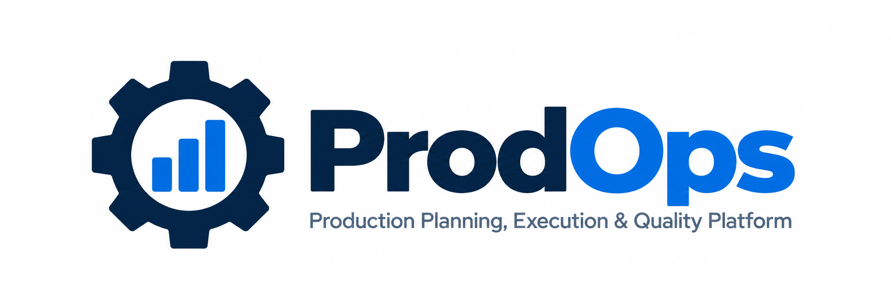
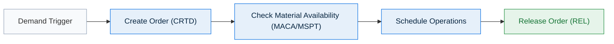
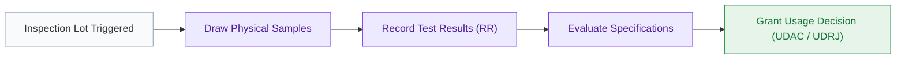
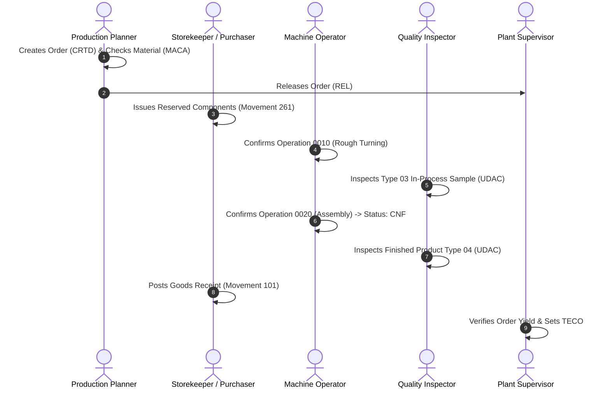

# PRODOPS — ROLE & MODULE GUIDE
## Enterprise Role Profiles, Responsibilities & Access Matrix

> **Document Type**: Client-Facing Role & Organizational Access Guide  
> **Product Name**: ProdOps  
> **Tagline**: Production Planning, Execution & Quality Platform  
> **Company**: Abhiyanta India Solutions Pvt. Ltd.  
> **Target Audience**: Department Heads, Plant Managers, Human Resources, Training Coordinators, System Administrators  
> **Document Code**: DOC-PROD-04-2026  

---

## 1. Persona-Driven Design Philosophy

Traditional enterprise manufacturing applications often present operators, supervisors, and planners with overly complex, generic interfaces crowded with irrelevant data fields and options.

**ProdOps** implements a strict **Persona-Driven Design Philosophy**. Every user who logs into ProdOps accesses a workspace curated specifically for their daily operational responsibilities:
* **Focus Over Clutter**: Buttons, navigation links, and operational menus that do not pertain to a user's role are cleanly hidden—not simply greyed out.
* **Error Prevention**: By restricting transactional actions (such as order release, component issue, or usage decisions) to authorized personas, the platform prevents inadvertent postings on the shop floor.
* **Streamlined Training**: Onboarding new employees requires teaching only the specific screens and tasks essential to their operational role.

---

## 2. Role-to-Module Access Matrix

The following matrix illustrates the exact module accessibility configured for each of the eight standard business personas:

| Business Role | Role Code | Dashboard | Production Orders | Order Details | Confirm Operations | Quality Control | Goods Movement | Stock & Inventory | Administration |
|---|:---:|:---:|:---:|:---:|:---:|:---:|:---:|:---:|:---:|
| **Production Planner** | `PROD_PLANNER` | **✓** | **✓** | **✓** | **✓** | **✓** | — | **✓** | — |
| **Plant Supervisor** | `PLANT_SUPV` | **✓** | **✓** | **✓** | **✓** | **✓** | — | **✓** | — |
| **Production Operator** | `PROD_OPERATOR` | **✓** | — | — | **✓** | — | — | — | — |
| **Quality Inspector** | `QUAL_INSPECTOR` | **✓** | — | — | — | **✓** | — | — | — |
| **Inventory Manager** | `INV_MANAGER` | **✓** | **✓** | **✓** | — | — | — | **✓** | — |
| **Purchaser / Storekeeper** | `PURCHASER` | **✓** | — | — | — | — | **✓** | — | — |
| **Plant / Operations Manager** | `PLANT_MGR` | **✓** | **✓** | **✓** | — | — | — | **✓** | — |
| **System Administrator** | `SYS_ADMIN` | **✓** | **✓** | **✓** | **✓** | **✓** | **✓** | **✓** | **✓** |

*Legend: **✓** = Fully Authorized Access; **—** = Screen Restricted / Hidden.*

---

## 3. Granular Role Profiles

### 3.1 Production Planner (`PROD_PLANNER`)

* **Primary Responsibility**: Plans, schedules, and balances production orders to fulfill customer orders and inventory replenishment targets without causing shop-floor starvation.
* **Main Screens**:
  * Dashboard (`/`)
  * Production Order Monitor (`/orders`)
  * Production Order Details (`/orders/:id`)
  * Stock & Inventory (`/inventory`)
* **Typical Daily Activities**:
  * Reviewing daily production demand and creating new manufacturing orders.
  * Running Material Availability Checks to identify shortages before dispatch.
  * Adjusting planned start/finish dates and setting scheduling margin keys.
  * Formally releasing orders (`REL`) to authorize shop-floor execution.
* **Authorized Actions**:
  * Create Production Order
  * Copy from Existing Order
  * Schedule Order
  * Release Order
  * Change Dates & Quantities

---

### 3.2 Plant Supervisor (`PLANT_SUPV`)
* **Primary Responsibility**: Oversees real-time line operations, resolves daily shop-floor exceptions, manages line handoffs, and authorizes technical completions.
* **Main Screens**:
  * Dashboard (`/`)
  * Production Orders (`/orders`)
  * Production Order Details (`/orders/:id`)
  * Confirm Operations (`/operations`)
  * Quality Control (`/quality`)
  * Stock & Inventory (`/inventory`)
* **Typical Daily Activities**:
  * Monitoring active order progression and work center utilization.
  * Intervening when operations report abnormal scrap or machine stoppages.
  * Executing Technical Completion (`TECO`) once manufacturing is finalized.
  * Performing TECO revocation when rework or corrective bookings are required.
* **Authorized Actions**:
  * Full supervisory view of all orders and operations.
  * Execute Technical Completion (`TECO`) & Revoke TECO.
  * Override operation confirmations when exceptions arise.

---

### 3.3 Production Operator (`PROD_OPERATOR`)

```mermaid
flowchart LR
    A["Active Work Queue"] --> B["Select Operation Step"]
    B --> C["Machine / Assembly Run"]
    C --> D["Enter Yield, Scrap & Hours"]
    D --> E["Submit Confirmation"]

    style A fill:#f8fafc,stroke:#94a3b8,stroke-width:1px
    style B fill:#e6f0fa,stroke:#016ce1,stroke-width:1px,color:#082641
    style C fill:#fef3c7,stroke:#d97706,stroke-width:1px,color:#78350f
    style D fill:#e6f0fa,stroke:#016ce1,stroke-width:1px,color:#082641
    style E fill:#e6f4ea,stroke:#1e8e3e,stroke-width:1px,color:#137333
```

* **Primary Responsibility**: Operates assigned machines and assembly work centers, executing routing steps and reporting actual yield, scrap, and labor hours.
* **Main Screens**:
  * Confirm Operations (`/operations`)
  * Executive Dashboard (`/`)
* **Typical Daily Activities**:
  * Opening the operation queue for their designated work center.
  * Reviewing routing steps, planned setup, and machine runtimes.
  * Recording produced yield and rejected scrap after completing runs.
  * Flagging partial (`PCNF`) vs. final (`CNF`) operation completion.
* **Authorized Actions**:
  * Operation Confirmations (Yield, Scrap, Labor/Machine Runtime).
  * *Restricted*: Operators cannot create, modify, or release orders, ensuring production adheres strictly to planned schedules.

---

### 3.4 Quality Inspector (`QUAL_INSPECTOR`)

* **Primary Responsibility**: Validates that in-process operations and finished products meet engineering specifications and regulatory quality standards.
* **Main Screens**:
  * Quality Control (`/quality`)
  * Executive Dashboard (`/`)
* **Typical Daily Activities**:
  * Inspecting In-Process inspection lots (Type 03) during machining or assembly.
  * Inspecting Post-Production inspection lots (Type 04) upon completion of final operations.
  * Logging sample inspection results, defect remarks, and non-conformances.
  * Executing formal Usage Decisions: Accepted (`UDAC`) or Rejected (`UDRJ`).
* **Authorized Actions**:
  * Result Recording (Sample size, defects, notes).
  * Usage Decision Authorization.

---

### 3.5 Inventory Manager (`INV_MANAGER`)
* **Primary Responsibility**: Monitors warehouse inventory levels, maintains storage location balances, and ensures material availability for production.
* **Main Screens**:
  * Stock & Inventory (`/inventory`)
  * Production Orders (`/orders`)
  * Dashboard (`/`)
* **Typical Daily Activities**:
  * Monitoring plant stock balances across Unrestricted, Quality, and Blocked categories.
  * Reviewing production order component demands and reservations.
  * Managing material replenishment to prevent production line starvation.
* **Authorized Actions**:
  * Inventory and stock level monitoring.
  * Order and component reservation tracking.

---

### 3.6 Purchaser / Storekeeper (`PURCHASER`)
* **Primary Responsibility**: Manages component issuing from warehouse bins to the shop floor and executes finished goods intake.
* **Main Screens**:
  * Goods Movement (`/goods-issue`)
  * Dashboard (`/`)
* **Typical Daily Activities**:
  * Pulling reserved components from warehouse shelves against production orders.
  * Executing Goods Issue via **Movement Type 261** in the standardized MIGO screen.
  * Receiving finished production batches into warehouse inventory via **Movement Type 101**.
  * Executing movement cancellations and reversals (**Movements 102 and 262**) when authorized.
* **Authorized Actions**:
  * Post Goods Issue (`261`)
  * Post Goods Receipt (`101`)
  * Post Movement Cancellations (`102`, `262`)

---

### 3.7 Plant / Operations Manager (`PLANT_MGR`)
* **Primary Responsibility**: Evaluates plant-wide manufacturing efficiency, throughput velocity, operational bottlenecks, and financial order closure.
* **Main Screens**:
  * Executive Dashboard (`/`)
  * Production Order Monitor (`/orders`)
  * Production Order Details (`/orders/:id`)
  * Stock & Inventory (`/inventory`)
* **Typical Daily Activities**:
  * Reviewing macro-level KPI indicators and order completion rates.
  * Monitoring scrap rates and yield discrepancies across product lines.
  * Overseeing financial order closure (`CLSD`) after cost settlements are verified.
* **Authorized Actions**:
  * Executive reporting and plant-wide analytics.
  * Authorizing Order Closure (`CLSD`).

---

### 3.8 System Administrator (`SYS_ADMIN`)
* **Primary Responsibility**: Manages user accounts, role assignments, system health, and data synchronization monitoring.
* **Main Screens**: Full access across all application modules, including Administration (`/admin`).
* **Typical Daily Activities**:
  * Provisioning new plant personnel and assigning business roles.
  * Monitoring enterprise synchronization health and event logging.
  * Maintaining master data integrity.

---

## 4. Cross-Functional Collaboration Workflow

The following diagram illustrates how multiple business roles interact sequentially through ProdOps to execute an order:

1. **Planner** creates the production order, validates material availability, and releases it for execution.
2. **Purchaser / Storekeeper** issues reserved raw materials directly against the order using Movement 261.
3. **Operator** turns the parts, reports confirmed yield, scrap, and machine time.
4. **Quality Inspector** evaluates intermediate and final test samples, granting an approved Usage Decision (`UDAC`).
5. **Purchaser / Storekeeper** posts completed assemblies into finished goods warehouse stock via Movement 101.
6. **Supervisor** verifies final yields and brings the order to Technical Completion (`TECO`).

---

## 5. Summary

By structuring platform access strictly according to business roles, ProdOps maintains high operational clarity, minimizes operator data-entry errors, and fosters accountability across every department in the manufacturing facility.
