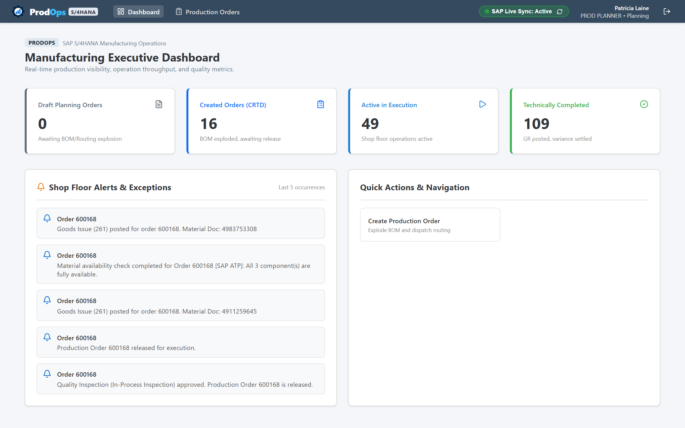
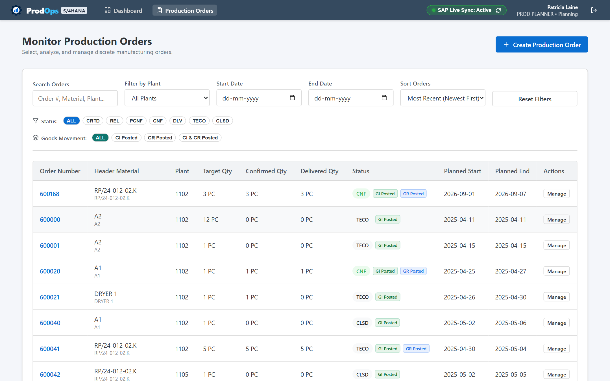
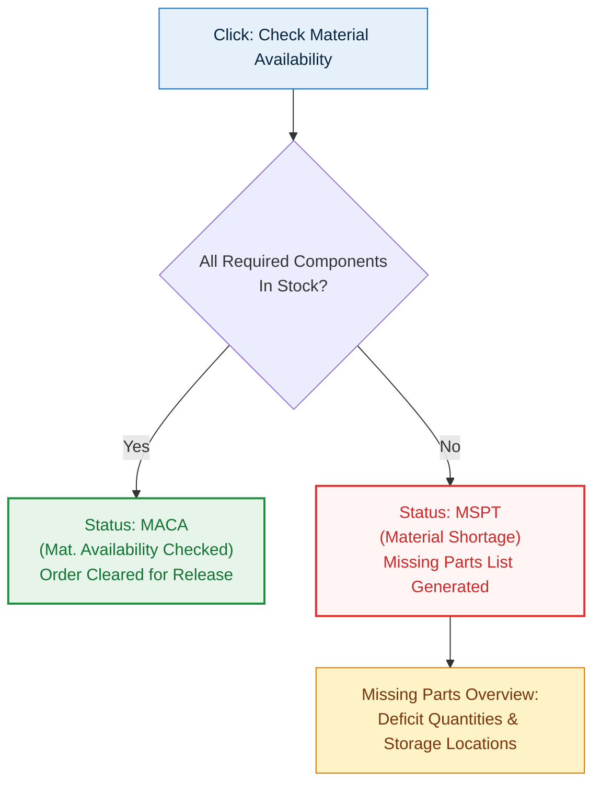
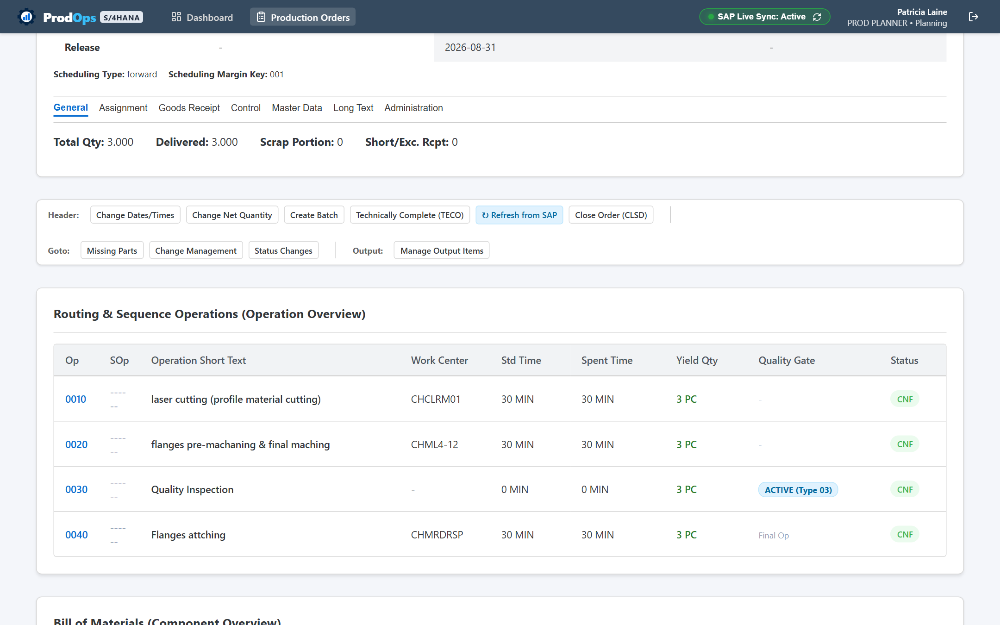
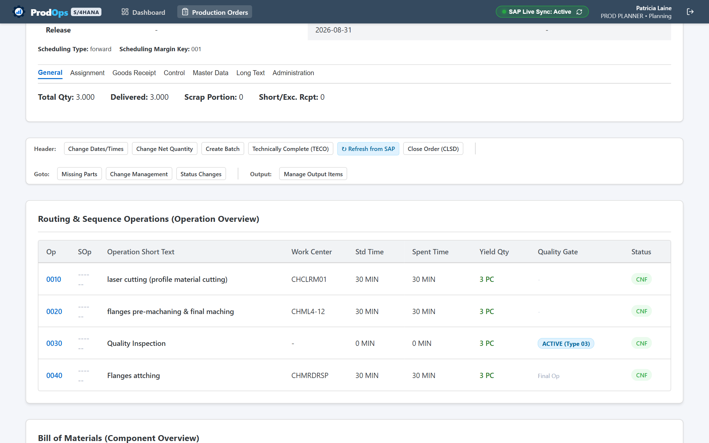
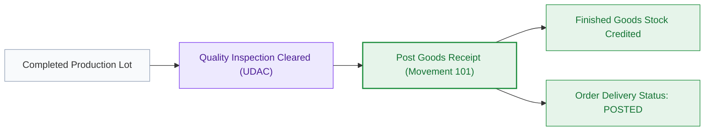
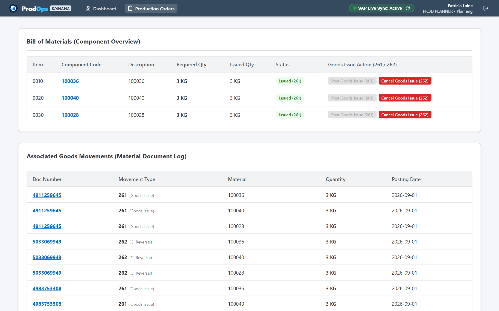
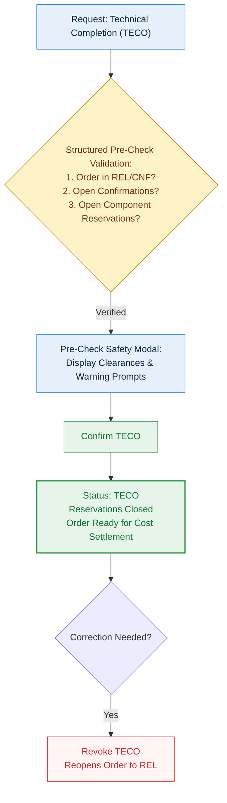

# PRODOPS — FEATURE & WORKFLOW GUIDE
## Visual Functional Architecture & Operational Walkthroughs

> **Document Type**: Client-Facing Visual Feature & Workflow Guide  
> **Product Name**: ProdOps  
> **Tagline**: Production Planning, Execution & Quality Platform  
> **Company**: Abhiyanta India Solutions Pvt. Ltd.  
> **Target Audience**: Continuous Improvement Teams, Plant Operations Leads, System Evaluators, Business Process Owners  
> **Document Code**: DOC-PROD-05-2026  

---

## 1. Document Purpose & Structure

The **ProdOps Feature & Workflow Guide** delivers a comprehensive visual examination of the fourteen core capabilities that drive the ProdOps platform. 

Each capability is documented using a standardized operational profile:
* **Feature Name & Business Purpose**: Why the feature exists and what manufacturing problem it solves.
* **Target Users**: The specific business personas who interact with it.
* **How It Works**: The operational workflow and underlying business rules.
* **Expected Outcome**: The measurable business result.
* **Visual Reference**: High-resolution application screenshots with numbered callouts.

---

## 2. Feature 1: Manufacturing Executive Dashboard

*Figure 5.1: Real-time operational dashboard with KPI counters and order status analytics.*

* **Purpose**: Provides plant managers, supervisors, and operations leads with an instant, consolidated summary of plant productivity, throughput velocity, and pending quality gates.
* **Who Uses It**: Plant Managers, Production Supervisors, Production Planners.
* **How It Works**:
  1. Aggregates data across all active production orders into five high-impact KPI summary cards: Total Orders, Orders in Execution, Pending Confirmations, Quality Lots Awaiting Decision, and Completed Orders.
  2. Displays an interactive Status Distribution chart showing order concentration across `CRTD`, `REL`, `PCNF`, `CNF`, `TECO`, and `CLSD`.
  3. Provides a live chronological feed of shop-floor milestones and confirmations.
* **Expected Outcome**: Eliminates manual status collection meetings and allows supervisors to detect operational bottlenecks in real time.

---

## 3. Feature 2: Production Order Monitor & Dynamic Search

*Figure 5.2: Central order tracking cockpit with status chips, plant selectors, and sync indicators.*

* **Purpose**: Acts as the central command center for locating, evaluating, and filtering production orders across multiple manufacturing plants.
* **Who Uses It**: Production Planners, Plant Supervisors, Inventory Managers.
* **How It Works**:
  1. **Instant Search**: Locates orders immediately by order number, material code, or finished product description.
  2. **Multi-Dimension Filters**: Refines order lists simultaneously by Primary Status (`CRTD`, `REL`, `PCNF`, `CNF`, `TECO`), Goods Movement state (`GI Pending`, `GI Posted`, `GR Pending`, `GR Posted`), and Plant ID.
  3. **Live Sync Badges**: Confirms data synchronization with central enterprise systems (`✓ SAP`).
* **Expected Outcome**: Planners and supervisors locate any order in seconds, instantly identifying delayed orders or unissued component shortages.

---

## 4. Feature 3: Production Order Creation & Reference Copying

*Figure 5.3: Production Order Creation dialog with master data validation and scheduling margins.*

* **Purpose**: Allows planners to generate authorized manufacturing orders against defined finished goods with automated BOM explosion and routing calculation.
* **Who Uses It**: Production Planners.
* **How It Works**:
  1. Planner selects the finished material, plant, target quantity, and receiving storage location.
  2. Planner sets basic scheduling dates and chooses between forward or backward scheduling.
  3. System applies scheduling margin keys (float before production, float after production, release period).
  4. System explodes the active Bill of Materials (BOM) to create material reservations and loads routing operations.
  5. *Optional*: Planner can use "Copy from Order" to duplicate configuration from a previously completed order.
* **Expected Outcome**: A standardized 10-digit production order number is generated in status `CRTD`, ready for material availability checking.

---

## 5. Feature 4: Production Order Detail & Header Management

*Figure 5.4: Production order header with multi-tab structure and SAP action toolbar.*

* **Purpose**: Provides a unified 360-degree view of an order's planning parameters, assignments, inventory delivery targets, and live execution status.
* **Who Uses It**: Production Planners, Plant Supervisors.
* **How It Works**:
  * Organizes order parameters across standardized business tabs:
    * **General**: Planned/actual dates, target quantity, priority, and scheduling margins.
    * **Assignment**: MRP controller, production supervisor, sales order references, and WBS elements.
    * **Goods Receipt**: Target storage location, batch indicators, and delivery tolerances.
    * **Control**: Costing variants, settlement rules, and scheduling parameters.
    * **Master Data**: Active BOM alternative, routing group counter, and production versions.
  * Provides quick-action buttons for manual SAP synchronization (`↻ Refresh from SAP`), order release, scheduling, and TECO.
* **Expected Outcome**: Comprehensive order visibility without requiring users to navigate across multiple disconnected enterprise transactions.

---

## 6. Feature 5: Material Availability Verification Engine

* **Purpose**: Prevents line stoppages by verifying that raw materials and sub-assemblies are physically available in inventory before releasing an order to the shop floor.
* **Who Uses It**: Production Planners, Plant Supervisors.
* **How It Works**:
  1. Triggered from the order action toolbar (**Check Availability**).
  2. Compares required quantities for all BOM components against current unrestricted warehouse stock.
  3. If sufficient stock exists: Status transitions to `MACA` (Material Availability Checked).
  4. If shortages exist: Status transitions to `MSPT` (Material Shortage) and generates a Missing Parts List displaying required vs. deficit quantities.
* **Expected Outcome**: Guarantees that only orders with confirmed material availability are released to the plant floor, drastically reducing idle machine time.

---

## 7. Feature 6: Production Order Release Workflow

* **Purpose**: Formally authorizes the plant floor to commence setup, material withdrawal, and manufacturing execution.
* **Who Uses It**: Production Planners, Plant Supervisors.
* **How It Works**:
  1. User reviews the order in status `CRTD` or `MACA`.
  2. User clicks **Release Order** on the action toolbar.
  3. System validates that the order is eligible for release.
  4. Status transitions from `CRTD` to `REL` (Released).
  5. Component reservations become active for warehouse withdrawal (Movement 261), and operation lines appear in operator worklists.
* **Expected Outcome**: Work center operators receive authorized jobs, and storekeepers are cleared to stage components.

---

## 8. Feature 7: Routing & Work Center Operation Sequences

*Figure 5.5: Chronological routing sequence displaying work centers, scheduled hours, and confirmed yield.*

* **Purpose**: Details the step-by-step manufacturing operations required to fabricate the finished item, including work center assignments and planned cycle times.
* **Who Uses It**: Machine Operators, Plant Supervisors, Manufacturing Engineers.
* **How It Works**:
  1. Displays operations in chronological sequence (e.g., `0010`, `0020`, `0030`).
  2. Shows assigned Work Center codes (e.g., `WC-LATHE-01`, `WC-MILL-02`).
  3. Details planned setup time and machine processing hours.
  4. Tracks cumulative confirmed yield against planned quantities for each step.
* **Expected Outcome**: Clear, unambiguous visibility into line progression and cycle-time performance across work centers.

---

## 9. Feature 8: Bill of Materials & Component Overview

*Figure 5.6: Bill of Materials overview showing component requirements, withdrawn quantities, and storage locations.*

* **Purpose**: Tracks raw material and assembly requirements, comparing planned consumption against actual warehouse withdrawals.
* **Who Uses It**: Production Planners, Storekeepers, Cost Accountants.
* **How It Works**:
  1. Lists all BOM component materials, descriptions, item numbers, and units of measure.
  2. Displays **Required Quantity** based on order batch size.
  3. Displays **Withdrawn Quantity** updated in real time upon goods issue.
  4. Displays issuing storage locations and batch assignments where applicable.
* **Expected Outcome**: Total accountability for raw material usage, preventing unauthorized component substitutions and shrinkage.

---

## 10. Feature 9: Shop-Floor Operation Confirmations

*Figure 5.7: Operation confirmation modal capturing yield, scrap, and actual runtimes.*

* **Purpose**: Records actual shop-floor production progress, updating completed piece counts, logging scrap, and debiting machine and labor runtimes.
* **Who Uses It**: Production Operators, Plant Supervisors.
* **How It Works**:
  1. Operator opens `/operations`, locating the active order and operation step.
  2. Operator enters produced **Yield Quantity** and rejected **Scrap Quantity**.
  3. Operator enters actual **Time Spent** (machine/labor minutes).
  4. Operator indicates whether the posting is a **Partial Confirmation** (`PCNF`) or **Final Confirmation** (`CNF`).
  5. Submitting the confirmation updates order progress and primary status.
* **Expected Outcome**: Immediate operational transparency on completed volumes and scrap rates without paper production logs.

---

## 11. Feature 10: Standardized Goods Issue (Movement Type 261)

*Figure 5.8: Standardized Goods Movement interface configured for Movement 261 component withdrawals.*

* **Purpose**: Issues raw materials, components, and packaging supplies from warehouse storage to the production order.
* **Who Uses It**: Storekeepers, Purchasers, Material Handlers.
* **How It Works**:
  1. User selects **Goods Issue (`A07`)** referencing an **Order (`R08`)**.
  2. System automatically retrieves reserved components and default issuing storage locations.
  3. User enters actual quantities to issue.
  4. User clicks **Check** to verify stock availability, followed by **Post**.
  5. System generates a Material Document, updates warehouse stock, and marks `goodsIssueStatus` as `POSTED`.
* **Expected Outcome**: Inventory balances reflect physical withdrawals, and actual material costs are debited to the production order.

---

## 12. Feature 11: Production Goods Receipt (Movement Type 101)

* **Purpose**: Receives finished assemblies into warehouse inventory upon completion of manufacturing operations.
* **Who Uses It**: Warehouse Storekeepers, Finished Goods Handlers.
* **How It Works**:
  1. Triggered via the Goods Movement workspace (`/goods-issue`) or Order Detail page.
  2. References the production order number and applies **Movement Type 101**.
  3. User confirms receipt quantity, plant, and destination storage location.
  4. Posting generates a Material Document, increments finished goods warehouse stock, and updates `goodsReceiptStatus` to `POSTED`.
* **Expected Outcome**: Finished products become immediately available in unrestricted inventory for sales delivery or subsequent production lines.

---

## 13. Feature 12: Goods Movement Reversals & Cancellations

* **Purpose**: Reverses erroneous goods issues or receipts with strict audit compliance and inventory rebalancing.
* **Who Uses It**: Storekeepers, Supervisors.
* **How It Works**:
  * **Goods Receipt Reversal (`101 → 102`)**: Cancels an incorrect goods receipt posting. Reverses the stock addition and reopens the delivered balance on the order.
  * **Goods Issue Reversal (`261 → 262`)**: Returns unused components from the shop floor back to warehouse inventory. Restores warehouse stock and credits material costs back to the order.
  * *Audit Control*: All reversals require entering the original Material Document number and generate a linked cancellation document (e.g., *"Cancelled by Material Document 4900001335"*).
* **Expected Outcome**: Complete correction of inventory balances without compromising financial or physical traceability.

---

## 14. Feature 13: Documented Goods Movements Log & Drill-Down

*Figure 5.9: Associated Goods Movements log with clickable Material Document links.*

* **Purpose**: Provides an immutable historical audit log of every inventory transaction executed against the production order.
* **Who Uses It**: Production Planners, Storekeepers, Financial Auditors.
* **How It Works**:
  1. Located directly on the Production Order Detail page under **Associated Goods Movements**.
  2. Displays all postings in chronological order, showing Material Document numbers, movement types (`101`, `261`, `102`, `262`), material codes, quantities, and timestamps.
  3. Clicking any Material Document number opens a **Drill-Down Modal** displaying document year, issuing storage location, and linked cancellation relationships.
* **Expected Outcome**: Audit-ready material traceability satisfying enterprise compliance and quality audit requirements.

---

## 15. Feature 14: Integrated Quality Inspection & Usage Decisions

*Figure 5.10: Quality Inspection Lot management with Result Recording and Usage Decisions.*

* **Purpose**: Embeds quality assurance directly into manufacturing execution, verifying that parts comply with engineering specifications before leaving the shop floor.
* **Who Uses It**: Quality Inspectors, Quality Managers.
* **How It Works**:
  1. **Inspection Lot Categories**:
     * **Type 03 (In-Process)**: Sample evaluations conducted during active operation steps.
     * **Type 04 (Post-Production)**: Comprehensive final lot evaluations before warehouse stocking.
  2. **Result Recording**: Inspector logs inspected sample size, defect counts, and qualitative findings.
  3. **Usage Decision**: Inspector authorizes formal disposition: **Accepted (`UDAC`)** or **Rejected (`UDRJ`)**.
* **Expected Outcome**: Defective batches are quarantined immediately, preventing non-conforming goods from entering finished inventory.

---

## 16. Feature 15: Technical Completion (TECO) & Order Closure Safety

* **Purpose**: Enforces strict business validations before bringing production orders to Technical Completion (`TECO`) or Final Financial Closure (`CLSD`).
* **Who Uses It**: Plant Supervisors, Plant Managers.
* **How It Works**:
  1. When a user clicks **TECO**, the system opens an interactive **Pre-Check Safety Modal**.
  2. The system verifies:
     * Order status eligibility (must be `REL`, `PCNF`, or `CNF`).
     * Open reservation status (confirms remaining material reservations will be cleared).
  3. Upon supervisor confirmation, the order advances to `TECO`.
  4. If corrections are needed later, authorized supervisors can select **Revoke TECO** to reopen the order.
  5. **Order Close (`CLSD`)**: Evaluates financial balance clearance ($\text{Actual Costs} - \text{Credits} = 0$) before permanently locking the order.
* **Expected Outcome**: Prevents premature order closures, ensures cost accounting integrity, and prevents orphaned open reservations.

---

## 17. Summary of Platform Workflows

The fourteen core features of ProdOps form a cohesive, enterprise-grade manufacturing execution suite. By pairing intuitive interfaces with disciplined business rules, ProdOps enables plant teams to operate with total alignment, high throughput, and uncompromising product quality.
